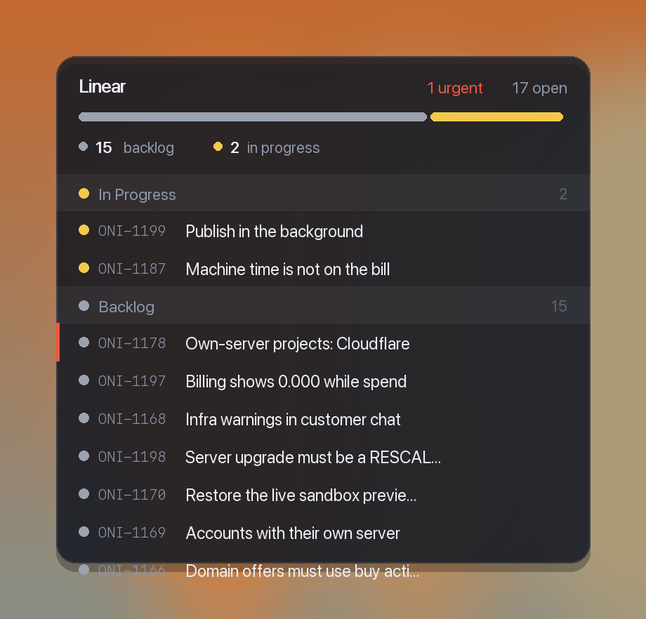

# ticketwall

**Your Linear tickets, up on your wall.**

Your open Linear tickets live on your macOS desktop. Glance at them; click one
to open it in Linear. No window to keep open, no tab to keep alive.

Runs on [Übersicht](https://tracesof.net/uebersicht/).



---

## Install

```bash
git clone https://github.com/majdiq1/ticketwall.git
cd ticketwall
./install.sh
```

It fetches Übersicht if you don't have it, copies the widget in, and asks for
your Linear API key. Then: Übersicht menu bar → **Refresh All Widgets**.

Remove it with `./uninstall.sh`.

---

## Using it

Once it's on your desktop there's nothing to learn — but here's everything it does.

**Open a ticket.** Click any row. It opens in the Linear desktop app if you
have it, otherwise your browser.

**Refresh now.** Click the word **Linear** at the top. It also refreshes itself
every minute.

**Read the bar.** The strip under the heading is your whole workload in one
line — each colour is a status, sized by how many tickets are in it. A wall of
grey means a big backlog; a lot of yellow means a lot in flight.

**Scroll** inside the list for tickets below the fold.

**Spot the urgent one.** A red line down the left edge of a row means priority
Urgent. The count also appears in red next to the heading.

**Move it.** Drag isn't supported — Übersicht has no drag. Change `POSITION` at
the top of `widget/linear.jsx` and save; it jumps immediately.

### If your list is too long

The widget shows everything open. On a big backlog that's a lot of scrolling.
Two things help:

- Raise `HEIGHT` and `LIST_HEIGHT` together to make it taller.
- Or edit the GraphQL `filter` in `widget/linear.jsx` — for example add
  `assignee: { isMe: { eq: true } }` to show only your own tickets.

---

## What it shows

- **Open tickets only.** Done, cancelled *and duplicate* issues are filtered
  out, so the count is the number of things actually in front of you. Duplicates
  matter more than you'd think — on my workspace they were 61 of 91 "open"
  issues.
- **Grouped sensibly.** More than one team, and it groups by team. One team, and
  it groups by status instead — because a single group header repeating your
  only team name tells you nothing.
- **Real Linear colours.** The status dots use the colours from your own Linear
  workflow, fetched with the data. Nothing is hardcoded.
- **Urgent issues** get a red edge down the left.
- **Assignees** appear as initials — but only if anyone is actually assigned.
  On an unassigned backlog the column is dropped rather than showing a row of
  dashes.

Clicking a ticket opens it in the **Linear desktop app** if you have it,
falling back to your browser. It matches the app by bundle id, so it keeps
working if the app is renamed or moved.

---

## Setup

You need a Linear personal API key:

**Linear → Settings → Security & access → Personal API keys**

The installer asks for it and saves it to `~/.linear-widget-token`, mode `600`.
You can also write it there yourself:

```bash
echo "lin_api_YOURKEY" > ~/.linear-widget-token
chmod 600 ~/.linear-widget-token
```

The key never leaves your Mac. The widget calls Linear's API directly.

---

## Options

At the top of `widget/linear.jsx`:

| | |
|---|---|
| `POSITION` | Where it sits. CSS against the screen edges — `bottom: 40px; left: 36px;` |
| `WIDTH` | Widget width, default 380 |
| `HEIGHT` | Fixed height, default 361 |
| `LIST_HEIGHT` | Scroll area, default 280 |
| `LIMIT` | Issues to fetch, default 150 |
| `refreshFrequency` | Default 60000 (1 minute) |

Click the **Linear** heading to refresh immediately.

---

## Troubleshooting

**"Add your Linear key to finish setup"** — the token file is missing or empty.

**"Linear rejected the request"** — the widget prints Linear's own error. A
revoked or mistyped key is the usual cause.

**Nothing appears at all** — check the widget is listed and visible in the
Übersicht menu bar icon. Übersicht draws on the desktop layer, so anything
covering your desktop covers the widget too.

---

## Licence

MIT. See [LICENSE](LICENSE).
